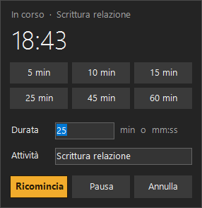
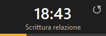
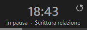

# Clessidra (Hourglass)

[🇮🇹 Italiano](README.md) · 🇬🇧 English

A countdown timer for **Windows 10/11** that helps you stay focused.
You set how long you want to work, the hourglass waits quietly next to the clock and, when time is up,
it plays a small **"ding"** and lets you know without interrupting what you are doing.

> The interface is in Italian.



## How it started

I'm not a programmer: I'm a consultant who helps small businesses use artificial intelligence.
I needed a timer to keep me from getting distracted while I work, with no windows popping up and no
intrusive sounds, so I described what I wanted and built it with **Claude Code**.
The AI wrote the code; I defined what I needed, tested and corrected the result.

The same approach works for the small operational annoyances of any business.
→ [marcofedeli.com](https://marcofedeli.com)

## What it does

- Lives in the **notification area**, next to the clock. Opens with **Ctrl+Alt+T** or a click on the hourglass.
- **Quick durations**: 5, 10, 15, 25, 45 and 60 minutes, one click. Or type your own:
  `25` (minutes), `1:30` (minutes and seconds), `90s`, `2,5`, `1h`.
- An optional **Attività** (activity) field reminds you what you are working on.
- While the timer runs, the **icon shows the minutes left** (amber; grey when paused).
- **On-screen countdown**: a small always-on-top box with the time left and a progress bar.
  It never takes focus, so it doesn't interrupt your typing.
  - **Drag** it anywhere; it remembers where you put it.
  - The **↺** button resets it to the starting duration (even after "Finito").
  - Double-click opens the panel, right-click opens the menu.
  - It can be turned off from the menu: **Countdown sullo schermo**.

    

- **Pause**, **Resume**, **Cancel** and **Restart**.
- When time is up: a **short, pleasant sound** (bell, double chime or soft gong, or none) and a
  **silent Windows notification** with the activity and duration. The sound is generated by the
  program: there are no audio files, and the Windows notification doesn't add its own.
- The panel can also be **dragged** from any empty area. If a window ends up in the wrong place,
  the menu has **Rimetti le finestre al loro posto** (put the windows back).
- Follows the Windows **light or dark theme**.
- **Start with Windows**, if you want, from the menu (one click to turn it on or off).
- Nothing to install, no dependencies: a single `.exe` of about 55 KB.

## Download

Download `Clessidra.exe` from the [**Releases**](../../releases) page and double-click it.
The hourglass appears next to the clock (if you don't see it, check the hidden icons under the **^** arrow).

> **Note:** the program is not digitally signed, so Windows may show
> "Windows protected your PC". Click **More info → Run anyway**.
> If you prefer, you can build it yourself from the source code (see below).

## How to use it

| Where | What you do |
|---|---|
| `Ctrl+Alt+T` or click on the hourglass | Opens and closes the panel |
| In the panel: type the duration and press `Enter` | Starts the timer (the panel closes by itself) |
| In the panel: `Esc` or click outside | Closes the panel |
| Right-click on the hourglass or the countdown | Menu: quick durations, pause, sound, start with Windows, exit |
| Countdown: drag | Move it anywhere |
| Countdown: **↺** | Start over |
| Countdown: click on "Finito" | Dismiss it |

## Building from source

Nothing to install: it uses the C# compiler that ships with Windows (.NET Framework 4.x).

```powershell
powershell -ExecutionPolicy Bypass -File build.ps1
```

It creates `Clessidra.exe` (and its icon) in the same folder. If Clessidra is running, the script closes it first.

## Where it stores data

Last duration, chosen sound, countdown on or off and window positions are in
`HKEY_CURRENT_USER\Software\Clessidra`. With **Start with Windows** on there is also a `Clessidra` value in
`HKEY_CURRENT_USER\Software\Microsoft\Windows\CurrentVersion\Run`.

**Uninstall:** untick **Avvia con Windows**, choose **Esci** (exit), delete the `.exe` and, if you like,
the key above.

## License

[MIT](LICENSE)
